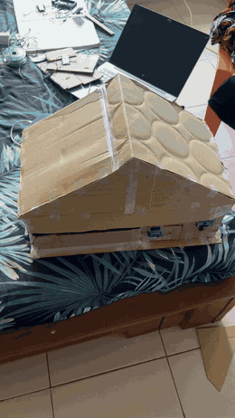

# Hi, I'm Maël Alain Bradley AZAÏNON

**Embedded Systems & IoT Student | Software Development | Electronics**

I am a third-year undergraduate student in **Embedded Systems and the Internet of Things (SE-IoT)** at the **Institut de Formation et de Recherche en Informatique (IFRI), Université d'Abomey-Calavi**, Benin.

I enjoy designing and understanding systems that connect software, electronics, and the physical world. Through academic projects and personal experiments, I am developing practical experience in embedded systems, IoT prototyping, application development, and system supervision.

---

## Areas of Interest

- Embedded systems and connected objects
- IoT architectures and sensor networks
- Electronics, sensors, and actuators
- Software and web application development
- Automation, monitoring, and cyber-physical system security

## Technologies & Tools

The following tools and technologies are part of my coursework and project experience:

| Area | Tools and technologies |
| --- | --- |
| Programming | Python, Java, C (AVR), C++ (ESP32), VHDL |
| Web development | Django, Flask, HTML, CSS, JavaScript |
| Databases | MySQL, SQLite |
| Embedded systems & electronics | Arduino, ATmega328P, ESP32, L298N, PIR sensor, HC-SR04 ultrasonic sensor, DHT11, RFID RC522, servo motors |
| IoT protocols & platforms | MQTT, EMQX Cloud |
| Simulation & supervision | ModelSim, GHDL, LabVIEW |
| Development tools | Git, GitHub, Visual Studio Code, PlatformIO, Eclipse, Maven, JUnit |
| Mapping | Leaflet |

*This list reflects tools used or explored in academic and project work; it is not a claim of expert-level proficiency in every technology.*

---

## Selected Projects

| Project | Domain | Stack |
| --- | --- | --- |
| [Smart Home](projects/smart-home/README.md) | IoT home automation | ESP32, MQTT/TLS, EMQX Cloud, RFID, PIR, DHT11 |
| [Smart Bin](https://github.com/bradley1101/smart-bin-iot) | Connected waste bins | ESP32, Flask, SQLite, WhatsApp API |
| [Water Tank & FDI](https://github.com/bradley1101/water-tank-fdi) | Cyber-physical security | Arduino, LabVIEW, Python |
| [Régulation de la vitesse d'un véhicule](https://github.com/bradley1101/obstacle-speed-control) | Embedded control | ATmega328P, register-level C, PWM |
| [Traffic Light Controller](https://github.com/bradley1101/traffic-light-vhdl) | Digital design | VHDL, ModelSim, GHDL |
| [Le Thermostat d'Alerte](https://github.com/bradley1101/thermostat-alerte-labview) | Supervision | LabVIEW, Python |
| [Medipass](https://github.com/bradley1101/medipass) | Software engineering | Java, DAO pattern, JDBC/MySQL, JUnit |
| [IFRI Comotorage](https://github.com/bradley1101/ifri-comotorage) | Web application | Python, Django, MySQL, Leaflet |

### 1. Smart Home — IoT Home Automation Prototype
A team project for the *IoT Systems Engineering and Design* course: a connected house with three ESP32 nodes (entrance, living room, kitchen) communicating over MQTT with a cloud broker (EMQX Cloud), built as a 47 × 28 cm cardboard prototype.

➡️ **[Project page: ESP32 firmware, wiring, MQTT topics, photos and video](projects/smart-home/README.md)**

### 2. Smart Bin — Connected Waste Bin
Each bin measures its fill level with an ultrasonic sensor, opens its lid when the collector approaches and sends a WhatsApp alert when it is full. A Flask server provides a supervisor dashboard and a mobile page for the collectors.

➡️ **[bradley1101/smart-bin-iot](https://github.com/bradley1101/smart-bin-iot)**

### 3. Water Tank Monitoring & False Data Injection
Arduino water-level control with LabVIEW supervision, and a study of how falsified sensor data can make a tank overflow. Defences: plausibility checks (range, rate, stuck value), cross-check with a float switch, and a hard-wired safety interlock that does not depend on the data it protects against.

➡️ **[bradley1101/water-tank-fdi](https://github.com/bradley1101/water-tank-fdi)**

### 4. Régulation de la vitesse d'un véhicule
A two-wheel vehicle adapts its speed to the distance to the obstacle in front of it. Register-level C on the ATmega328P: Timer1 input capture for the HC-SR04, Timer0 Fast PWM for the L298N, median filter and acceleration ramp, plus a closed-loop simulation.

➡️ **[bradley1101/obstacle-speed-control](https://github.com/bradley1101/obstacle-speed-control)**

### 5. Traffic Light Controller — VHDL
Moore state machine for a two-road intersection (all-red clearance, vehicle detection, pedestrian button, night mode), verified by a self-checking testbench in ModelSim / GHDL.

➡️ **[bradley1101/traffic-light-vhdl](https://github.com/bradley1101/traffic-light-vhdl)**

### 6. Le Thermostat d'Alerte — LabVIEW
Temperature supervision with high/low alarms, 3-zone status, trend chart and alert counter, with an analysis of its limits (chattering, cycle counting) and their corrections (hysteresis, rising-edge counting).

➡️ **[bradley1101/thermostat-alerte-labview](https://github.com/bradley1101/thermostat-alerte-labview)**

### 7. Medipass — Java Application
A digital medical pass (patients, doctors, consultations) structured around the DAO pattern, with interchangeable MySQL and in-memory storage, and unit tests.

➡️ **[bradley1101/medipass](https://github.com/bradley1101/medipass)**

### 8. IFRI Comotorage — Carpooling Application
A Django platform connecting drivers and passengers of the IFRI community: rides placed on a Leaflet map, search, booking with driver approval, in-app messaging, notifications, mutual reviews and a dashboard. Runs on MySQL or SQLite, 32 automated tests.

➡️ **[bradley1101/ifri-comotorage](https://github.com/bradley1101/ifri-comotorage)**

---

## Education

**Licence 3 — Embedded Systems and Internet of Things (SE-IoT)**  
Institut de Formation et de Recherche en Informatique (IFRI)  
Université d'Abomey-Calavi — Benin

---

## What I'm Working Towards

I am continuously strengthening my technical foundations through hands-on projects, experimentation, and documentation. I am particularly interested in opportunities to contribute to practical projects involving embedded systems, IoT, electronics, and software development.

## Languages

- French — Fluent
- English — Technical reading and learning

---

*Thanks for visiting my profile. Feel free to explore my repositories as I continue documenting my work and progress.*
