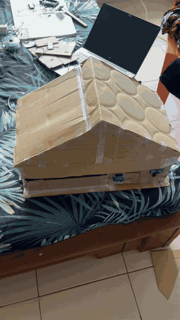
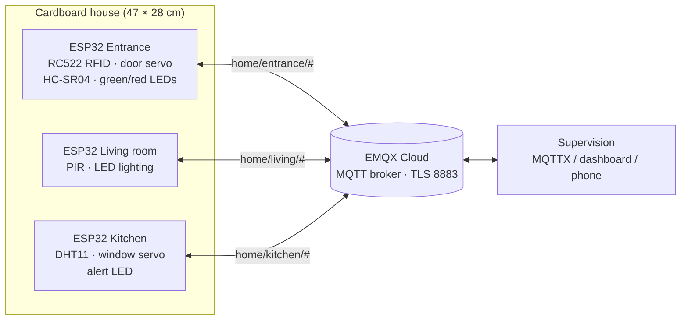
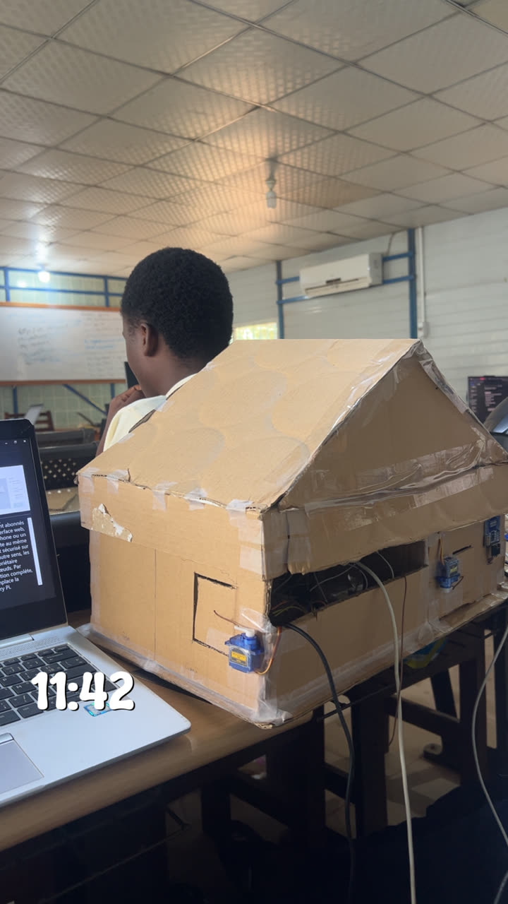
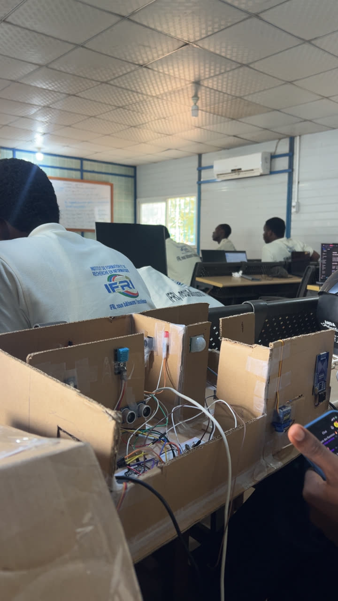

# Smart Home — IoT Home Automation Prototype

Academic project for the course **IoT Systems Engineering and Design** (*Ingénierie et conception des systèmes IoT*), Embedded Systems & IoT programme, **IFRI — Université d'Abomey-Calavi** (Benin).

<p align="center">
  
</p>

▶️ **[Full prototype video (MP4)](media/prototype-demo.mp4)**

---

## Overview

The goal of the project is to design a connected home in which sensors and actuators are placed where they are actually needed in the house, each with a clear role, and supervised remotely through an MQTT broker.

To validate the design, the team built a **physical small-scale prototype**: a cardboard house on a **47 × 28 cm** rectangular base, with every part made of cardboard except the electronic components.

## Architecture



| Node | Equipment | Role |
| --- | --- | --- |
| **Entrance** | RC522 RFID reader, SG90 servo, HC-SR04, green/red LEDs | Badge access control, motorised door (auto-close after 5 s), visitor detection |
| **Living room** | PIR HC-SR501, LEDs | Presence-based lighting, manual override from MQTT |
| **Kitchen** | DHT11, SG90 servo, red LED | Temperature/humidity monitoring, overheat alert, automatic ventilation window |

## Repository content

```
smart-home/
├── firmware/              PlatformIO project, one environment per node
│   ├── platformio.ini
│   ├── include/
│   │   ├── config.h           pin map and thresholds
│   │   ├── net.h              Wi-Fi + MQTT/TLS helper (shared)
│   │   └── secrets.example.h  template for credentials
│   └── src/
│       ├── entrance/main.cpp
│       ├── living/main.cpp
│       └── kitchen/main.cpp
├── docs/
│   ├── wiring.md          wiring tables for each node
│   └── mqtt.md            MQTT topics and payloads
└── media/                 photos and video of the prototype
```

- 🔌 **[Wiring](docs/wiring.md)**
- 📡 **[MQTT topics](docs/mqtt.md)**

## Build & flash

Requirements: [VS Code + PlatformIO](https://platformio.org/install/ide?install=vscode) and an EMQX Cloud deployment.

```bash
cd firmware
cp include/secrets.example.h include/secrets.h   # then fill in Wi-Fi + EMQX credentials
pio run -e entrance -t upload                    # repeat with: living, kitchen
pio device monitor
```

To add a badge: flash the entrance node, present the badge, read its UID on the serial monitor and add it to `AUTHORIZED_UIDS` in `config.h`.

## Photos

| Assembled house | Inside the rooms |
| --- | --- |
|  |  |

## Status & next steps

- [x] Physical architecture: equipment placed in the house with the role of each device
- [x] Cardboard prototype with sensors and actuators wired to the ESP32 nodes
- [x] ESP32 firmware for the 3 nodes and MQTT topic structure
- [ ] Supervision dashboard
- [ ] Simulation of the prototype in **Cooja**

## Team

- **AZAÏNON Maël Alain Bradley**
- **DEKADJEVI Elom**
- **GOUNOUKON Uriel**

**Supervisor:** Ida TOGNISSE
